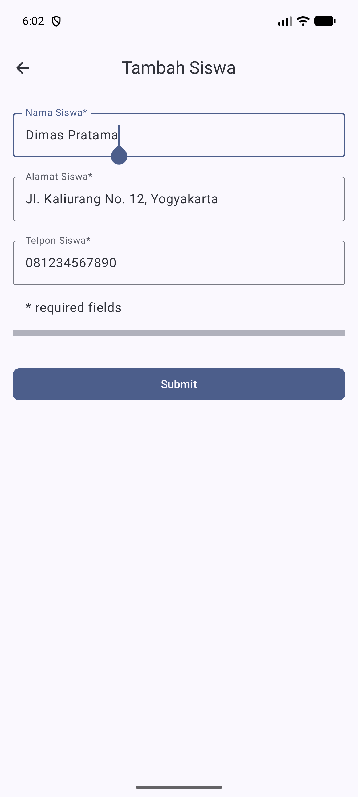
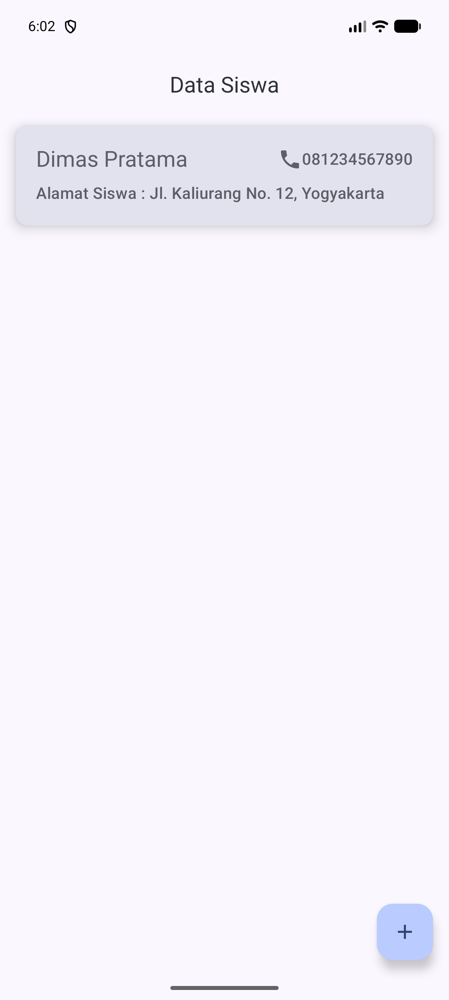

# Aplikasi Data Siswa

Aplikasi Android sederhana untuk mencatat data siswa. Aplikasi dibuat dengan Kotlin, Jetpack Compose, dan Room untuk penyimpanan lokal.

## Fitur

- Melihat daftar siswa yang tersimpan.
- Menambahkan nama, alamat, dan nomor telepon siswa.
- Memeriksa agar semua kolom wajib diisi.
- Menyimpan data secara lokal menggunakan Room.

## Menjalankan aplikasi

1. Buka proyek ini di Android Studio.
2. Tunggu Gradle selesai melakukan sinkronisasi.
3. Pilih emulator atau perangkat Android dengan API 37 atau lebih baru.
4. Jalankan konfigurasi `app`.

Untuk membuat APK debug dari terminal, gunakan JDK yang didukung Android Gradle Plugin:

```bash
./gradlew :app:assembleDebug
```

## Screenshot aplikasi

Screenshot di bawah diambil dari aplikasi yang berjalan pada emulator Android 17 (API 37). Form diisi dengan data uji, lalu data disimpan dan ditampilkan pada halaman beranda.

### Halaman tambah siswa



### Halaman beranda setelah data disimpan


